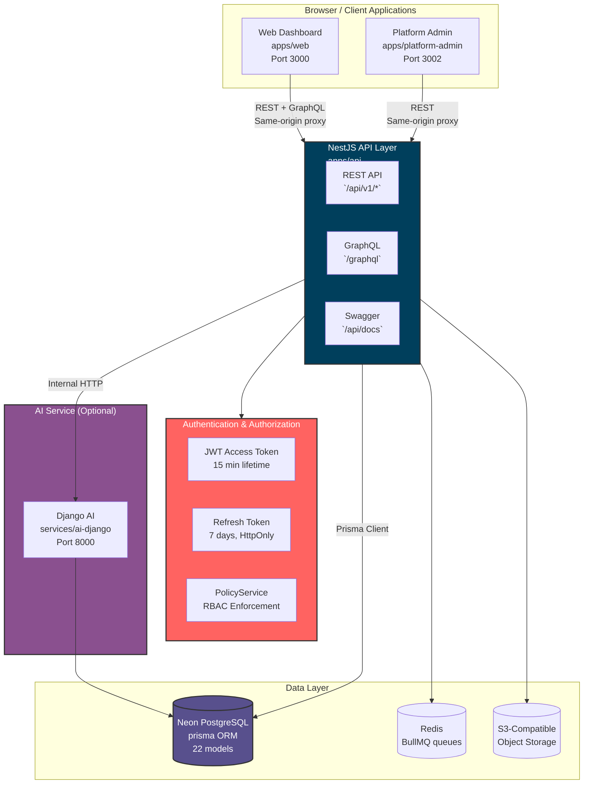
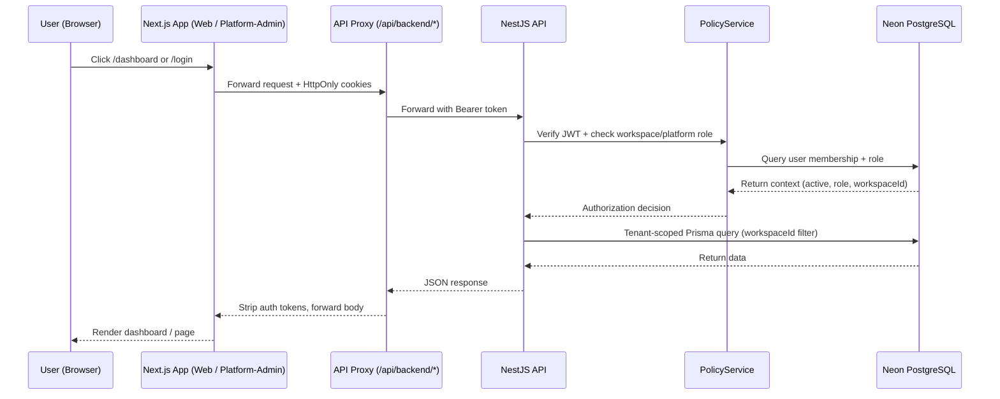

# TriFusion AI

**AI-Powered Business Workspace for freelancers, digital agencies, and IT service companies.**

TriFusion AI brings clients, projects, tasks, team collaboration, role-based access control, audit history, and AI assistance into one secure, multi-tenant workspace platform. Built as a monorepo with Next.js 16, NestJS 10, Prisma, and PostgreSQL.

[](https://github.com/abx15/trifusion-ai)
[](https://github.com/abx15/trifusion-ai)
[](LICENSE)
[](https://nodejs.org/)
[](https://pnpm.io/)
[](https://www.typescriptlang.org/)

---

## What Is TriFusion AI?

TriFusion AI is an **AI-powered business workspace** that unifies client management, project tracking, task workflows, team collaboration, and AI assistance into a single permission-controlled platform. Each customer gets an isolated workspace with granular role-based access control (RBAC), while platform staff operate in a strictly separated administrative layer.

### Core Capabilities

| Capability | Description |
|------------|-------------|
| **Multi-tenant Workspaces** | Personal and company workspaces with strict tenant isolation — customers never see each other's data |
| **Role-Based Access Control** | 8 roles across 2 disjoint layers: 4 workspace roles + 4 platform staff roles |
| **Clients, Projects, Tasks** | Full CRUD with soft-archive/restore, status transitions, assignees, due dates |
| **Activity Feed** | Cursor-paginated audit trail of all workspace changes |
| **Real-time Dashboards** | Role-specific layouts (Bento, Grid, Kanban, List) with live data from the API |
| **AI Assistant** | Project summaries, weekly reports, task suggestions, and bounded Q&A via a separate Django service |
| **Audit & Security** | Hash-chained audit logs, JWT auth with HttpOnly cookies, privilege-escalation guards |
| **Platform Administration** | Separate staff portal for tenant management, user activation, audit viewing, and support sessions |

---

## Architecture Diagram



### Data Flow (Request Lifecycle)



---

## Repository Layout

```
trifusion-ai/
├── apps/
│   ├── api/                 # NestJS REST + GraphQL API (port 3001)
│   ├── web/                 # Customer-facing Next.js dashboard (port 3000)
│   └── platform-admin/      # Platform staff admin portal (port 3002)
├── packages/
│   ├── ui/                  # Shared Material UI design system
│   ├── contracts/           # Shared API types, schemas, role configs
│   ├── config/              # Shared ESLint/TypeScript/tooling config
│   └── utils/               # Shared utilities (formatting, dates, sanitization)
├── services/
│   └── ai-django/           # Separate Django AI service (port 8000, optional)
├── database/
│   ├── prisma/              # Prisma schema, migrations, client
│   ├── seeds/               # Development-only seed script (guarded)
│   └── docs/                # ERD and database notes
├── infrastructure/
│   ├── docker/              # Multi-stage Dockerfiles per service
│   ├── deployment/          # Deployment configs
│   └── monitoring/          # Monitoring/alerting configs
├── tests/
│   └── e2e/                 # Playwright E2E test suites
├── scripts/                 # Code generation and utility scripts
├── docs/                    # Comprehensive documentation
└── package.json             # Root pnpm workspace config (Turborepo)
```

---

## Technology Stack

| Layer | Technology | Version |
|-------|-----------|---------|
| Monorepo / Build | Turborepo + pnpm workspaces | pnpm 8.15.0 |
| Language | TypeScript | 5.x |
| Customer Web | Next.js 16 (App Router), React 19 | Next.js 16.0.0 |
| Platform Admin | Next.js 16 (App Router), React 19 | Next.js 16.0.0 |
| API | NestJS 10 | NestJS 10.x |
| UI Framework | Material UI (MUI) v7 + Emotion | MUI v7 |
| API Docs | Swagger / OpenAPI | @nestjs/swagger |
| GraphQL | Apollo GraphQL | GraphQL 16 |
| Database | PostgreSQL (Neon) | Prisma ORM v5 |
| Cache / Queues | Redis + BullMQ | ioredis v5 |
| Auth | JWT (access 15m + refresh 7d) | passport-jwt |
| AI Service | Python Django | Django 5.x |
| Testing | Jest + Playwright | Jest 29, Playwright 1.64 |
| Linting / Formatting | ESLint + Prettier | ESLint 8, Prettier 3 |

---

## Local Development Setup

### Prerequisites

- **Node.js 18 or newer**
- **pnpm 8 or newer** (repository pins pnpm 8.15.0)
- **Python 3.12+** (only if running the AI Django service)
- **PostgreSQL** (Neon or local) for API/database work

### 1. Clone and Install

```bash
git clone https://github.com/abx15/trifusion-ai.git
cd trifusion-ai
pnpm install
```

This generates the Prisma client automatically via the `postinstall` hook.

### 2. Configure Environment Files

Copy the templates for each app you intend to run:

```text
.env.example                         -> .env
apps/api/.env.example                -> apps/api/.env
apps/web/.env.example                -> apps/web/.env
apps/platform-admin/.env.example     -> apps/platform-admin/.env
```

Use fake/local values in development. Keep real `.env` files out of version control. At minimum:

- Set `AUTH_SECRET` (32+ characters) in `apps/api/.env`
- Set `DATABASE_URL` and `DIRECT_URL` pointing to your **development** database
- Set `API_INTERNAL_URL` in each Next.js app (e.g. `http://localhost:3001/api/v1`)
- Never put credentials in `NEXT_PUBLIC_*` variables

### 3. Database Setup (Development Only)

```bash
# Generate Prisma client
pnpm db:generate

# Apply development migrations
pnpm db:migrate

# Open Prisma Studio (optional)
pnpm db:studio
```

### 4. Seed Test Data (Development Only)

Seeding is restricted to development databases. You must set a separate `DATABASE_URL_SEED` that differs from your runtime `DATABASE_URL`, and opt in explicitly:

```bash
NODE_ENV=development \
ALLOW_DEV_SEED=true \
DATABASE_URL_SEED=<separate-dev-database-url> \
pnpm db:seed
```

**Test credentials after seeding** (all share password `Password123!`):

| Email | Role | Layer |
|-------|------|-------|
| owner@trifusion.dev | OWNER | Customer Workspace |
| admin@trifusion.dev | TEAM_ADMIN | Customer Workspace |
| member@trifusion.dev | MEMBER | Customer Workspace |
| viewer@trifusion.dev | VIEWER | Customer Workspace |
| superadmin@trifusion.dev | SUPERADMIN | Platform Staff |
| platformadmin@trifusion.dev | PLATFORM_ADMIN | Platform Staff |
| analyst@trifusion.dev | ANALYST | Platform Staff |
| support@trifusion.dev | SUPPORT_AGENT | Platform Staff |

See `LOGIN_CREDENTIALS.md` for full details and API examples.

### 5. Start the Applications

From the repository root, use separate terminals:

```bash
# API backend
pnpm --filter @trifusion/api start:dev      # http://localhost:3001

# Customer web dashboard
pnpm --filter @trifusion/web dev             # http://localhost:3000

# Platform admin portal
pnpm --filter @trifusion/platform-admin dev  # http://localhost:3002
```

Optional AI service:

```bash
cd services/ai-django
python manage.py runserver 0.0.0.0:8000     # http://localhost:8000
```

### Local URLs

| Application | URL |
|-------------|-----|
| Customer Web Dashboard | http://localhost:3000 |
| NestJS API | http://localhost:3001 |
| Swagger/OpenAPI Docs | http://localhost:3001/api/docs |
| GraphQL Endpoint | http://localhost:3001/graphql |
| Platform Admin Portal | http://localhost:3002 |
| AI Django Service (optional) | http://localhost:8000 |

GraphQL Playground and introspection are **disabled in production**. Production API errors are mapped to safe messages.

---

## Common Commands

| Command | Description |
|---------|-------------|
| `pnpm dev` | Start all workspace development tasks |
| `pnpm build` | Build all workspace packages and applications |
| `pnpm lint` | Lint all workspace packages |
| `pnpm typecheck` | Type-check all workspace packages |
| `pnpm test` | Run all workspace test scripts |
| `pnpm db:generate` | Generate Prisma client from schema |
| `pnpm db:migrate` | Create/apply a development migration |
| `pnpm db:migrate:deploy` | Deploy committed migrations to configured database |
| `pnpm db:seed` | Run guarded development seed |
| `pnpm db:studio` | Open Prisma Studio database GUI |

### API-Specific Commands

```bash
# Run unit tests (excludes DB integration suites)
pnpm --filter @trifusion/api exec jest --runInBand --testPathIgnorePatterns='integration.spec.ts'

# Run all tests including integration (requires isolated test DB)
pnpm --filter @trifusion/api exec jest --runInBand

# Start API in debug mode
pnpm --filter @trifusion/api start:debug
```

---

## Authorization Model

TriFusion AI uses **8 roles across 2 completely separate authorization layers**. They are never mixed.

### Customer Workspace Roles (`apps/web`)

Per-workspace (tenant-scoped) roles stored in `WorkspaceMember.role`:

| Role | Level | Purpose | Can Create Resources? |
|------|-------|---------|----------------------|
| `OWNER` | 4 | Full workspace control, billing, member management, deletion | ✅ |
| `TEAM_ADMIN` | 3 | Day-to-day team administration, member management | ✅ |
| `MEMBER` | 2 | Standard contributor — creates/edits tasks, projects, clients | ✅ |
| `VIEWER` | 1 | Read-only stakeholder — monitors progress | ❌ |

### Platform Staff Roles (`apps/platform-admin`)

Global platform roles stored in `PlatformStaffRole.role`:

| Role | Level | Purpose | Customer Data Access? |
|------|-------|---------|----------------------|
| `SUPERADMIN` | 4 | Platform configuration, staff role management, global settings | ❌ (bounded only) |
| `PLATFORM_ADMIN` | 3 | Tenant/user activation, operational administration | ❌ (bounded only) |
| `ANALYST` | 1 | Global telemetry, usage quotas, performance metrics | ❌ |
| `SUPPORT_AGENT` | 2 | Time-bounded, consent-based support sessions | ❌ (bounded session only) |

**No platform role has ambient access to customer workspace content.** Emergency support access generates an immutable `PLATFORM_SUPPORT_ACCESS` audit event.

See `docs/ROLES_REFERENCE.md` for the complete permissions matrix.

---

## API Reference

### Base Conventions

- **Base Prefix**: `/api/v1`
- **Auth**: `Authorization: Bearer <access_token>`
- **Tenant Context**: `X-Workspace-Id: <uuid>` (verified server-side)
- **Errors**: Standard `{ statusCode, timestamp, path, message, errors }` envelope

### Authentication Endpoints

| Method | Endpoint | Description | Auth Required |
|--------|----------|-------------|---------------|
| `POST` | `/api/v1/auth/register` | Register new user + personal workspace | No |
| `POST` | `/api/v1/auth/login` | Authenticate with email + password | No |
| `POST` | `/api/v1/auth/refresh` | Refresh expired access token | No |
| `POST` | `/api/v1/auth/logout` | Invalidate refresh token | Yes |
| `GET` | `/api/v1/auth/me` | Current user profile + workspaces | Yes |
| `POST` | `/api/v1/auth/forgot-password` | Request password reset token | No |
| `POST` | `/api/v1/auth/reset-password` | Reset password with valid token | No |

### Workspace Domain REST APIs

| Resource | Routes |
|----------|--------|
| Clients | `GET/POST /api/v1/workspaces/:workspaceId/clients` |
| Clients | `GET/PATCH/DELETE(archive) /api/v1/workspaces/:workspaceId/clients/:clientId` |
| Projects | `GET/POST /api/v1/workspaces/:workspaceId/projects` |
| Projects | `GET/PATCH/DELETE(archive) /api/v1/workspaces/:workspaceId/projects/:projectId` |
| Tasks | `GET/POST /api/v1/workspaces/:workspaceId/tasks` |
| Tasks | `GET/PATCH /api/v1/workspaces/:workspaceId/tasks/:taskId` |
| Tasks | `PATCH .../tasks/:taskId/status` |
| Activity | `GET /api/v1/workspaces/:workspaceId/activity` |
| Settings | `GET/PATCH /api/v1/workspaces/:workspaceId/settings` |
| Analytics | `GET /api/v1/workspaces/:workspaceId/analytics/*` |

### GraphQL (Read-Only)

Endpoint: `POST /graphql`

- `workspaceOverview(workspaceId, filters)` — project/task counts, overdue tasks, upcoming deadlines
- `projects(workspaceId, limit, cursor, status, clientId)` — cursor-paginated projects
- `tasks(workspaceId, limit, cursor, status, priority, projectId, assigneeId)` — cursor-paginated tasks
- `recentActivity(workspaceId, limit, cursor)` — cursor-paginated activity feed

GraphQL depth is capped at 5, complexity at 100, and resolver execution at 5 seconds. Introspection/playground disabled in production.

### Platform Admin Endpoints

| Method | Endpoint | Required Role |
|--------|----------|---------------|
| `GET` | `/api/v1/platform/metrics` | SUPERADMIN, PLATFORM_ADMIN, ANALYST |
| `GET` | `/api/v1/platform/workspaces` | SUPERADMIN, PLATFORM_ADMIN |
| `GET` | `/api/v1/platform/users` | SUPERADMIN, PLATFORM_ADMIN |
| `GET` | `/api/v1/platform/staff/me` | Any platform staff |
| `GET` | `/api/v1/platform/audit-logs` | SUPERADMIN, PLATFORM_ADMIN, ANALYST |

See `docs/API_CONTRACTS.md` for complete request/response schemas and examples.

---

## Security & Tenancy

- **Workspace membership, role checks, and resource scoping are enforced by the API.** Frontend role gating is UX only.
- **Browser authentication** uses same-origin proxy routes and HttpOnly cookies. Access and refresh tokens are never stored in browser `localStorage`.
- **Authenticated responses are not publicly cached.**
- **Never commit `.env` files, access tokens, database credentials, or provider secrets.**
- **Use separate development, test, and production databases.** Never point test/seed variables at production.
- **Audit logs** are hash-chained for tamper-evidence and append-only (no update/delete endpoints).
- **Last-owner protection** prevents a workspace from being left without an OWNER.
- **Last-SUPERADMIN protection** prevents the final platform superadmin from being revoked.

See `docs/SECURITY.md` for the complete security guide.

---

## Documentation

| Document | Path | Description |
|----------|------|-------------|
| Architecture Diagrams | `docs/ARCHITECTURE_DIAGRAMS.md` | Mermaid diagrams: system, data flow, auth, deployment |
| User Guide | `docs/USER_GUIDE.md` | Role-specific dashboard walkthroughs for all 8 roles |
| API Contracts | `docs/API_CONTRACTS.md` | Complete OpenAPI-style request/response reference |
| Authorization Matrix | `docs/AUTHORIZATION_MATRIX.md` | Full permissions matrix for all 8 roles |
| Roles Reference | `docs/ROLES_REFERENCE.md` | Role hierarchy, enforcement, code path |
| Database Design | `docs/DATABASE_DESIGN.md` | Prisma schema, ERD, indexing, retention |
| System Architecture | `docs/SYSTEM_ARCHITECTURE.md` | High-level architecture and technology decisions |
| Deployment Guide | `docs/DEPLOYMENT.md` | Docker, environment variables, health checks |
| Security Guide | `docs/SECURITY.md` | Security best practices and configuration |
| Runbook | `docs/RUNBOOK.md` | Operational procedures and incident response |
| Development Roadmap | `docs/DEVELOPMENT_ROADMAP.md` | Phase status and remaining work |
| ADRs | `docs/ADRs/` | Architecture Decision Records (14 ADRs) |
| Design System | `docs/DESIGN_SYSTEM.md` | Material UI theme, components, usage |

---

## Contributing

1. Create a feature branch from `main`.
2. Make a focused change and update directly related documentation.
3. Run lint, typecheck, build, and relevant tests.
4. Never use the production database for development or test validation.
5. Submit a pull request with checks performed and any remaining gaps noted.

---

## License

UNLICENSED — All rights reserved.

---

## Support

For deployment issues, see `docs/RUNBOOK.md` and `docs/INCIDENT_RESPONSE.md`. For questions about role behavior, see `docs/ROLES_REFERENCE.md` and `docs/AUTHORIZATION_MATRIX.md`.