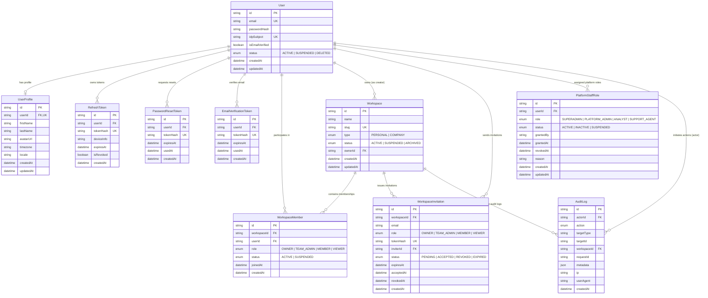
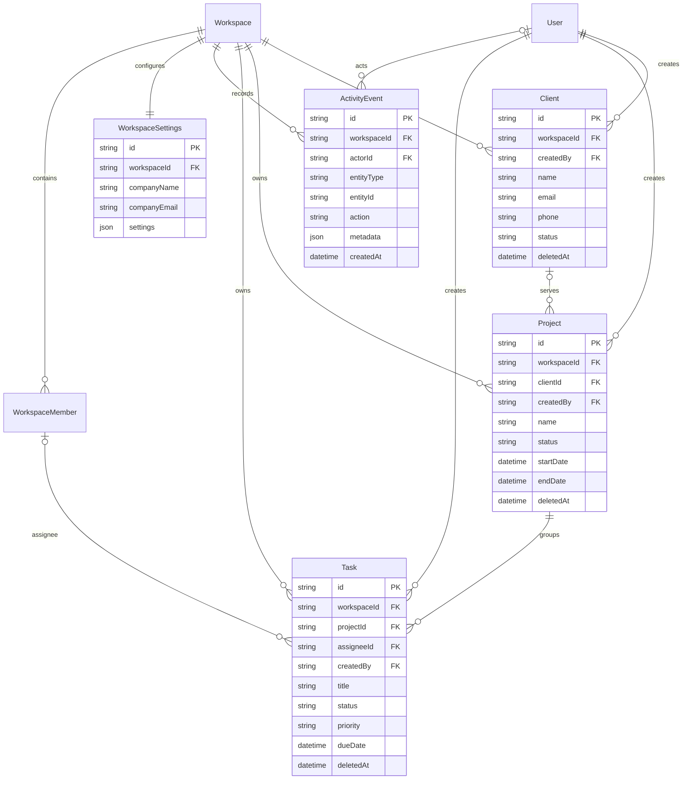

# TriFusion AI — Entity Relationship Diagram (ERD)

> **Database Engine:** PostgreSQL 15+  
> **Schema Management:** Prisma ORM  
> **Last Updated:** Phase 2 (Identity & Multi-Tenancy)

---

## 1. High-Level Entity Diagram

---

## 2. Integrity & Deletion Policies

| Parent Model | Dependent Model | Relation | Deletion Strategy | Rationale |
|---|---|---|---|---|
| `User` | `UserProfile` | `1 : 1` | `CASCADE` | Profile data cannot exist without its base user. |
| `User` | `RefreshToken` | `1 : N` | `CASCADE` | All session tokens must purge if the user is deleted. |
| `User` | `PasswordResetToken` | `1 : N` | `CASCADE` | Reset tokens are invalid if user account is pruned. |
| `User` | `EmailVerificationToken` | `1 : N` | `CASCADE` | Verification tokens purge with user. |
| `User` | `WorkspaceMember` | `1 : N` | `CASCADE` | Membership records remove on user deletion. |
| `User` | `PlatformStaffRole` | `1 : N` | `CASCADE` | Internal roles drop with user identity. |
| `User` | `Workspace` (`ownerId`) | `1 : N` | `RESTRICT` | A user cannot be deleted while registered as sole workspace owner without ownership transfer. |
| `Workspace` | `WorkspaceMember` | `1 : N` | `CASCADE` | When workspace is deleted, its memberships are removed. |
| `Workspace` | `WorkspaceInvitation`| `1 : N` | `CASCADE` | Invitations to a deleted workspace are immediately purged. |
| `Workspace` | `AuditLog` | `1 : N` | `SET NULL` | Audit records must remain intact for compliance even if workspace is deleted. |
| `User` (`actorId`) | `AuditLog` | `1 : N` | `CASCADE` | GDPR/compliance hard-delete cascading for test actors (in production, soft-delete is enforced). |

---

## 3. Phase 3 Workspace Domain

`Project(workspaceId, clientId)` references `Client(workspaceId, id)`. `Task(workspaceId, projectId)` references `Project(workspaceId, id)` and `Task(workspaceId, assigneeId)` references `WorkspaceMember(workspaceId, userId)`. Assignment additionally requires an active membership in the domain service.

Every domain table has workspace and workload indexes. Soft-archiving sets `deletedAt` and retains child history; active tasks block project archival, and active projects block client archival. See [`DATABASE_DESIGN.md`](../../docs/DATABASE_DESIGN.md) for allowed status transitions and retention rules.
