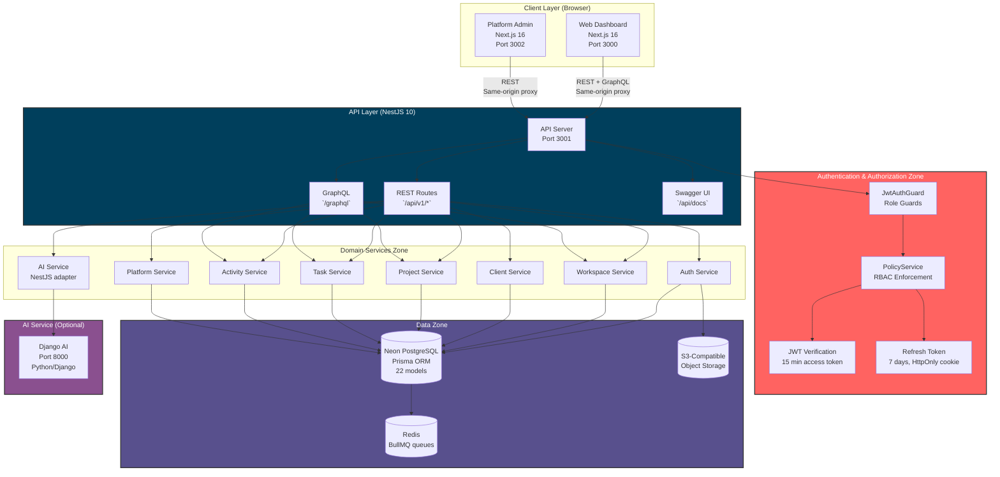
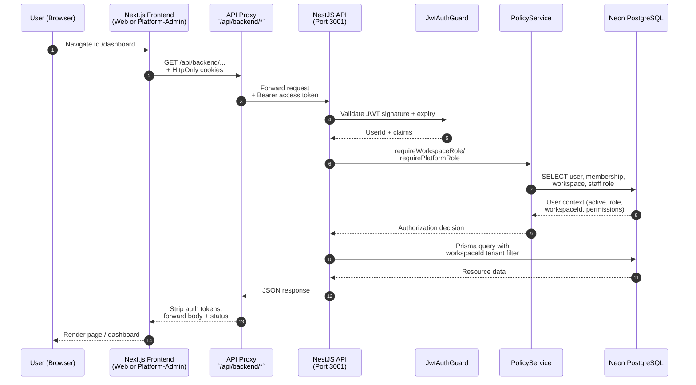
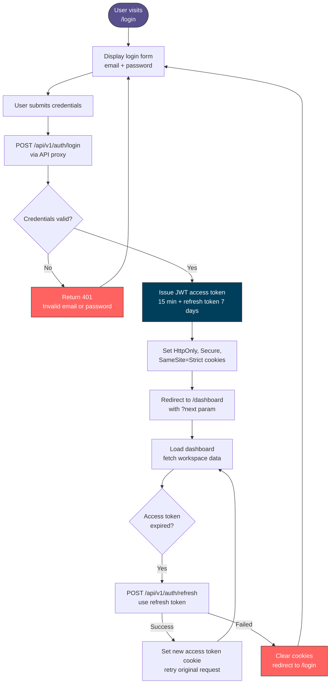
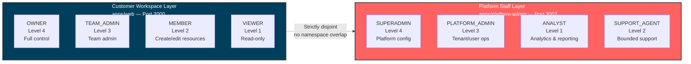
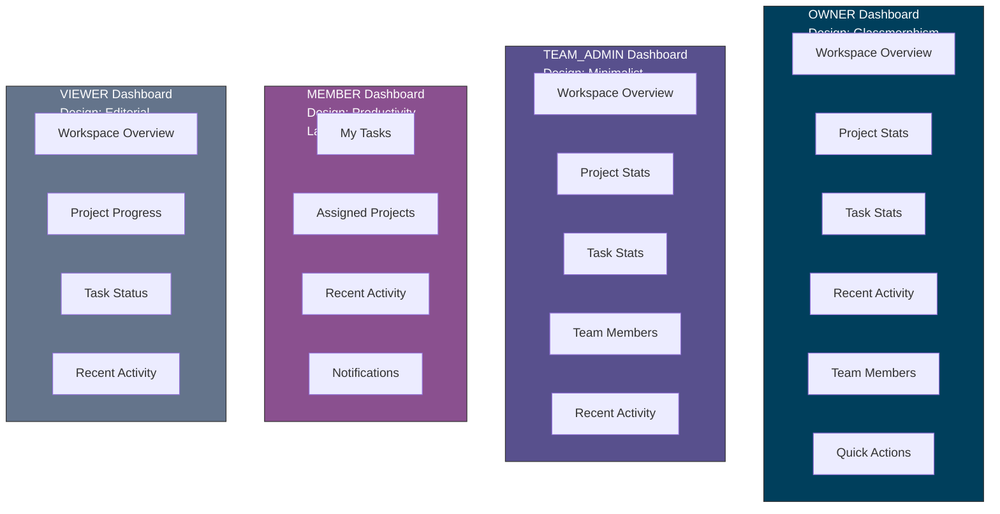
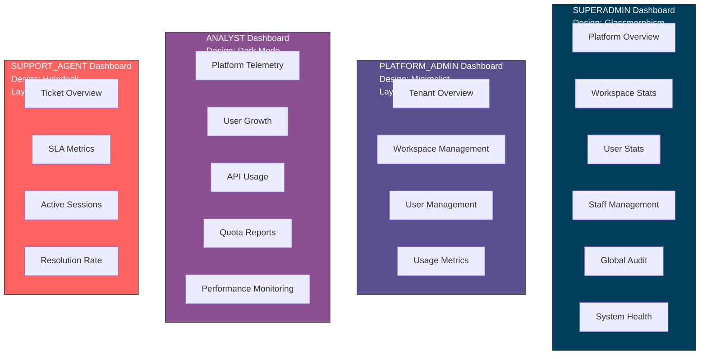
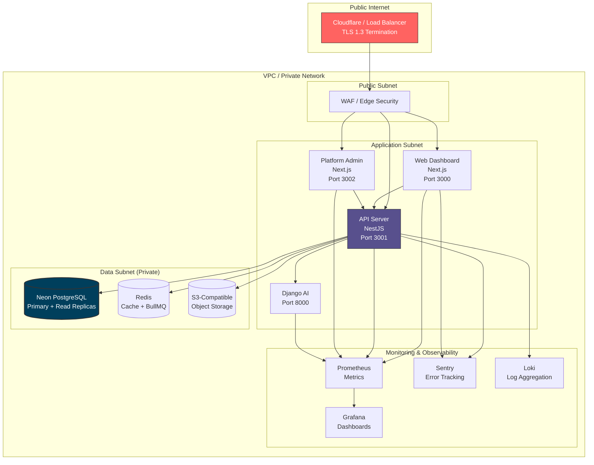
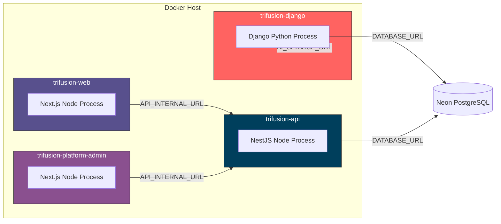
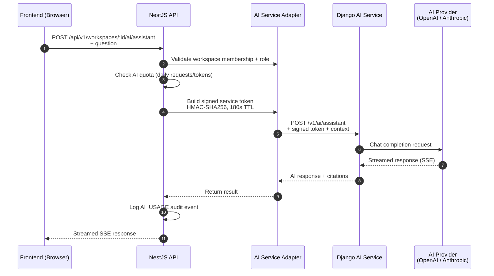

# TriFusion AI — Architecture Diagrams

This document contains Mermaid diagrams illustrating the system architecture, data flows, authentication, authorization, deployment, and database relationships for TriFusion AI.

> **Tip:** These diagrams render in GitHub, GitLab, VS Code (with Mermaid extensions), and most Markdown viewers that support Mermaid.

---

## 1. System Architecture (High-Level)



---

## 2. Request Lifecycle (Sequence Diagram)



---

## 3. Authentication Flow



---

## 4. Authorization Decision Flow

```mermaid
flowchart TD
    Start([HTTP request arrives]) --> Ctx[Extract userId from<br/>verified JWT]
    Ctx --> Layer{Request targets<br/>workspace or platform?}

    Layer -->|Workspace| WSPath[Workspace Layer]
    Layer -->|Platform| PLPath[Platform Staff Layer]

    WSPath --> WSResolve[PolicyService.resolveUser()<br/>check user is ACTIVE]
    WSResolve --> WSContext[getWorkspaceContext()<br/>check membership ACTIVE +<br/>workspace ACTIVE]
    WSContext --> WSHierarchy[Compare ROLE_HIERARCHY<br/>context.role >= requiredRole]
    WSHierarchy --> WSPass{Role sufficient?}
    WSPass -->|No| WS403[Return 403 Forbidden]
    WSPass -->|Yes| WSService[Domain Service<br/>Prisma query with workspaceId filter]

    PLPath --> PLResolve[getPlatformStaffContext()<br/>check staff role ACTIVE]
    PLResolve --> PLHierarchy[Compare PLATFORM_ROLE_HIERARCHY<br/>context.role >= requiredRole]
    PLHierarchy --> PLPass{Role sufficient?}
    PLPass -->|No| PL403[Return 403 Forbidden]
    PLPass -->|Yes| PLService[Domain Service<br/>platform-scoped query]

    WSService --> DB[(Neon PostgreSQL)]
    PLService --> DB
    DB --> Result[Return data to controller]
    Result --> Response[Return JSON response]

    style WS403 fill:#FF6361,stroke:#333,color:#fff
    style PL403 fill:#FF6361,stroke:#333,color:#fff
    style WSService fill:#003F5C,stroke:#333,color:#fff
    style PLService fill:#58508D,stroke:#333,color:#fff
```

---

## 5. Role Separation (Two Disjoint Layers)



---

## 6. Database Entity Relationship (ERD)

```mermaid
erDiagram
    USER ||--o{ USER_PROFILE : "has one"
    USER ||--o{ REFRESH_TOKEN : "has many"
    USER ||--o{ PASSWORD_RESET_TOKEN : "has many"
    USER ||--o{ EMAIL_VERIFICATION_TOKEN : "has many"
    USER ||--o{ WORKSPACE_MEMBER : "member of many"
    USER ||--o{ PLATFORM_STAFF_ROLE : "has many"
    USER ||--o{ WORKSPACE : "owns many"
    USER ||--o{ WORKSPACE_INVITATION : "invites many"
    USER ||--o{ AUDIT_LOG : "acts in many"
    USER ||--o{ CLIENT : "creates many"
    USER ||--o{ PROJECT : "creates many"
    USER ||--o{ TASK : "creates many"
    USER ||--o{ ACTIVITY_EVENT : "performs many"
    USER ||--o{ NOTIFICATION : "receives many"

    WORKSPACE ||--o{ WORKSPACE_MEMBER : "has many members"
    WORKSPACE ||--o{ WORKSPACE_INVITATION : "has many invitations"
    WORKSPACE ||--o{ AUDIT_LOG : "has many audit logs"
    WORKSPACE ||--o{ CLIENT : "contains many"
    WORKSPACE ||--o{ PROJECT : "contains many"
    WORKSPACE ||--o{ TASK : "contains many"
    WORKSPACE ||--o{ ACTIVITY_EVENT : "has many events"
    WORKSPACE ||--o{ WORKSPACE_SETTINGS : "has one settings"
    WORKSPACE ||--o{ NOTIFICATION : "sends many"
    WORKSPACE ||--o{ ENTITLEMENT : "has one entitlement"
    WORKSPACE ||--o{ PRIVILEGED_ACCESS_GRANT : "target of many"
    WORKSPACE ||--o{ FILE_ASSET : "contains many"
    WORKSPACE ||--o{ JOB_RECORD : "has many jobs"

    WORKSPACE_MEMBER }o--|| USER : "belongs to user"
    WORKSPACE_MEMBER }o--|| WORKSPACE : "belongs to workspace"
    WORKSPACE_MEMBER ||--o{ TASK : "assigned to many"

    CLIENT ||--o{ PROJECT : "has many projects"
    PROJECT ||--o{ TASK : "has many tasks"
    TASK }o--|| WORKSPACE_MEMBER : "assigned to member"

    PLAN ||--o{ ENTITLEMENT : "defines"
    ENTITLEMENT }o--|| WORKSPACE : "assigned to"
    FEATURE_FLAG ||--o{ FEATURE_FLAG_CHANGE : "has changes"

    PRIVILEGED_ACCESS_GRANT }o--|| USER : "requested by"
    PRIVILEGED_ACCESS_GRANT }o--|| WORKSPACE : "target workspace"

    USER_PROFILE {
        string id PK
        string userId UK FK
        string firstName
        string lastName
        string avatarUrl
        string timezone
        string locale
    }

    USER {
        string id PK
        string email UK
        string passwordHash
        string idpSubject UK
        boolean isEmailVerified
        enum UserStatus status
        datetime createdAt
        datetime updatedAt
    }

    WORKSPACE {
        string id PK
        string name
        string slug UK
        enum WorkspaceType type
        enum WorkspaceStatus status
        string ownerId FK
        datetime createdAt
    }

    WORKSPACE_MEMBER {
        string id PK
        string workspaceId FK
        string userId FK
        enum WorkspaceRole role
        enum WorkspaceMemberStatus status
        datetime joinedAt
    }

    CLIENT {
        string id PK
        string workspaceId FK
        string name
        string email
        string phone
        enum ClientStatus status
        string createdBy FK
        datetime deletedAt
    }

    PROJECT {
        string id PK
        string workspaceId FK
        string clientId FK
        string name
        string description
        enum ProjectStatus status
        datetime startDate
        datetime endDate
        string createdBy FK
        datetime deletedAt
    }

    TASK {
        string id PK
        string workspaceId FK
        string projectId FK
        string assigneeId FK
        string title
        string description
        enum TaskStatus status
        enum TaskPriority priority
        datetime dueDate
        string createdBy FK
        datetime deletedAt
    }

    AUDIT_LOG {
        string id PK
        string actorId FK
        enum AuditAction action
        string targetType
        string targetId
        string workspaceId FK
        string requestId
        json metadata
        string chainHash
        datetime createdAt
    }
```

---

## 7. Dashboard Role Layouts

### Customer Workspace Dashboards (`apps/web`)



### Platform Staff Dashboards (`apps/platform-admin`)



---

## 8. Deployment Architecture



---

## 9. Docker Container Architecture



---

## 10. AI Service Request Flow



---

## Diagram Legend

| Color | Meaning |
|-------|---------|
| `#003F5C` | API / Core Backend |
| `#58508D` | Secondary services, Platform Admin |
| `#8A508F` | AI, Analytics, MEMBER role |
| `#FF6361` | Errors, auth, SUPPORT_AGENT, Django |
| `#64748B` | VIEWER role, neutral elements |
