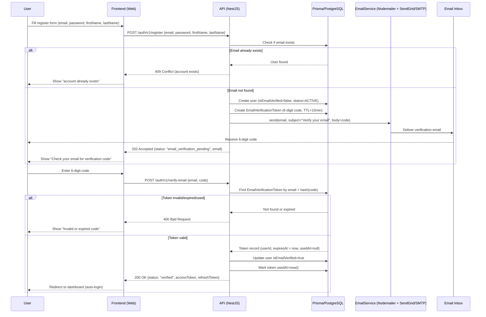
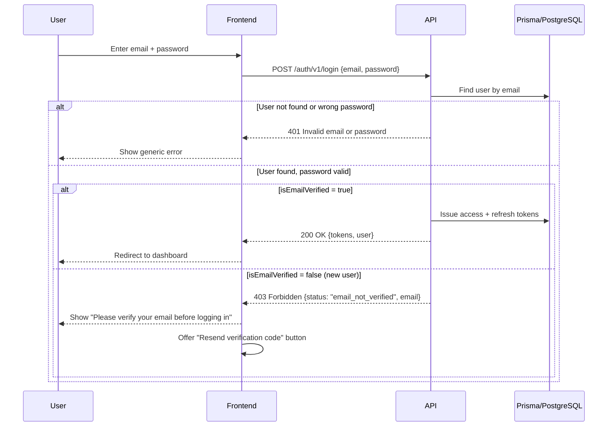
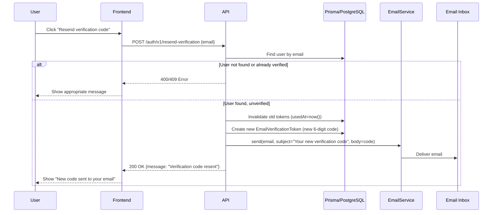

# Email Verification System — Plan & Architecture

## Overview

Add mandatory email verification for **all new user registrations** going forward. Existing users already in the database are **exempt** — they can continue to login without verification. New users must:

1. Register → account created with `isEmailVerified = false`
2. Receive a 6-digit verification code via email
3. Submit the code → `isEmailVerified` set to `true`
4. Only then can they login and access the app

Every subsequent login for an unverified new user requires email verification first.

---

## Mermaid Flow Diagrams

### Registration Flow (New Users)



### Login Flow (New Users — Verification Required)



### Resend Verification Flow



---

## Database Schema (Already Present)

The following models already exist in `database/prisma/schema.prisma`:

**`User.isEmailVerified`** — `Boolean @default(false)` (line ~167)

**`EmailVerificationToken`** (lines 277-294):
```prisma
model EmailVerificationToken {
  id        String   @id @default(uuid())
  userId    String
  user      User     @relation(fields: [userId], references: [id], onDelete: Cascade)
  tokenHash String   @unique
  expiresAt DateTime
  usedAt    DateTime?
  createdAt DateTime @default(now())
  @@index([userId])
  @@index([expiresAt])
}
```

No schema changes are needed — both tables/columns already exist but are **unused** by the auth flow.

---

## API Endpoints (New & Modified)

| Method | Endpoint | Auth | Description |
|--------|----------|------|-------------|
| `POST` | `/auth/v1/register` | Public | Modified: creates unverified user, sends code, returns `202` pending |
| `POST` | `/auth/v1/login` | Public | Modified: rejects if `isEmailVerified = false` (new users) |
| `POST` | `/auth/v1/verify-email` | Public | **New**: validates 6-digit code, sets `isEmailVerified = true`, issues tokens |
| `POST` | `/auth/v1/resend-verification` | Public | **New**: invalidates old tokens, generates new code, resends email |

---

## DTOs (New Files)

### `apps/api/src/modules/auth/dto/verify-email.dto.ts`
```typescript
export class VerifyEmailDto {
  @IsEmail() email!: string;
  @IsString() @IsNotEmpty() @Length(6, 6) code!: string;
}
```

### `apps/api/src/modules/auth/dto/resend-verification.dto.ts`
```typescript
export class ResendVerificationDto {
  @IsEmail() email!: string;
}
```

---

## Service Layer Changes

### `AuthService.register()` — Modified
- Creates user with `isEmailVerified = false` (already the default)
- Does **NOT** issue JWT tokens or set cookies
- Creates `EmailVerificationToken` (6-digit numeric code, TTL 15 min)
- Calls `EmailService.send()` to deliver the code
- Returns `202` with `{ status: "email_verification_pending", email }`

### `AuthService.login()` — Modified
- After successful password check: if `user.isEmailVerified === false` → throw `403` with `{ status: "email_not_verified", email }`
- Verified users proceed normally with token issuance

### `AuthService.verifyEmail()` — New
- Looks up `EmailVerificationToken` by `tokenHash` (SHA-256 of the 6-digit code)
- Validates: not used, not expired, belongs to the given email's user
- Sets `user.isEmailVerified = true`, marks token `usedAt = now()`
- Issues JWT access + refresh tokens, sets cookies
- Returns `{ status: "verified", tokens, user }`

### `AuthService.resendVerification()` — New
- Finds user by email (must exist and be unverified)
- Marks all existing tokens for that user as `usedAt = now()`
- Creates a new `EmailVerificationToken`
- Sends new code via `EmailService.send()`
- Returns `{ message: "Verification code resent" }`

---

## Email Workers Architecture

### EmailService (Existing)

Located at `apps/api/src/modules/email/email.service.ts`. Uses **nodemailer** with dual transport:

1. **SMTP** — if `SMTP_HOST`, `SMTP_USER`, `SMTP_PASSWORD` are configured
2. **SendGrid** — if `SENDGRID_API_KEY` is configured (relays through `smtp.sendgrid.net`)
3. **Disabled** — if neither is configured, `transporter = null` and `send()` throws `ServiceUnavailableException`

### Email Worker Flow (Synchronous → Async Future)

Current implementation is **synchronous** (API waits for `sendMail` to complete). For production scale, the plan is:

```
┌─────────────────┐      ┌──────────────────┐      ┌─────────────────┐
│   API Controller│─────▶│   Email Queue    │─────▶│   Email Worker  │
│  (AuthService)  │      │  (Redis/BullMQ)  │      │  (Nodemailer)   │
└─────────────────┘      └──────────────────┘      └─────────────────┘
                                                        │
                                                        ▼
                                               ┌─────────────────┐
                                               │   SMTP /        │
                                               │   SendGrid API  │
                                               └─────────────────┘
```

**Why async workers:**
- Email delivery can take 1–5 seconds; API should not block the user on it
- Retry with exponential backoff on transient SMTP failures
- Dead-letter queue for permanently failed verification emails (alert admin)
- Rate limiting per email address to prevent abuse

**Immediate (this PR):** Keep synchronous `EmailService.send()` for simplicity. Add a comment/TODO marking where to plug in a BullMQ/Redis queue later.

### Email Templates

Two plain-text templates (HTML can be added later):

1. **Verification code email** — subject: "Verify your email — TriFusion AI"
   - Body includes the 6-digit code, 15-minute expiry, and a note to ignore if not requested

2. **Resend verification email** — subject: "Your new verification code — TriFusion AI"
   - Same structure, notes that the previous code is invalidated

---

## Edge Cases & Security

| Scenario | Handling |
|----------|----------|
| User already verified tries `/verify-email` | Return `200` with "already verified" message (idempotent) |
| Expired token used | Return `400` "Invalid or expired verification code" |
| Token already used | Mark as consumed; reject reuse |
| Brute-force on 6-digit code | Token is single-use; after failure, user must request resend (rate-limited) |
| Email not configured | `EmailService.send()` throws `ServiceUnavailableException`; API returns `503` |
| Existing (pre-migration) users | Exempt — `isEmailVerified` may already be `true` or they logged in before; login works as before |
| Resend spam | Invalidate prior tokens; server-side rate limit (e.g., 1 resend per 60 seconds per email) — TODO |

---

## Files to Change

| File | Action |
|------|--------|
| `apps/api/src/modules/auth/auth.service.ts` | Modify `register()`, `login()`; add `verifyEmail()`, `resendVerification()`, `createVerificationToken()`, `sendVerificationEmail()` helpers; inject `EmailService` |
| `apps/api/src/modules/auth/auth.controller.ts` | Add `POST /verify-email` and `POST /resend-verification` routes; modify `register()` and `login()` status codes |
| `apps/api/src/modules/auth/auth.module.ts` | Import `EmailModule`, add `EmailService` to providers/inject |
| `apps/api/src/modules/auth/dto/verify-email.dto.ts` | **Create** |
| `apps/api/src/modules/auth/dto/resend-verification.dto.ts` | **Create** |
| `docs/EMAIL_VERIFICATION.md` | **Create** (this file) |

---

## Next Step

Once you confirm ("karo" / implement), I will:

1. Create the two new DTO files
2. Modify `auth.service.ts`, `auth.controller.ts`, `auth.module.ts`
3. Run `prisma migrate dev` to create a migration (schema already has the tables)
4. Run `pnpm run build` to verify TypeScript compilation
5. Run `pnpm run lint` to verify code quality
