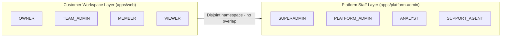

# TriFusion AI — Roles & Role-Based Access Control Reference

> **Document Status:** Active Reference  
> **Scope:** Customer Workspace Roles (`apps/web`) + Platform Staff Roles (`apps/platform-admin`)  
> **Database:** Neon PostgreSQL (`neondb`)  
> **ORM:** Prisma Client  
> **Policy Enforcement:** `PolicyService` (`apps/api/src/common/policy/policy.service.ts`)

---

## 1. Overview: How Many Roles Are There

TriFusion AI uses **8 roles total**, split into **two separate, disjoint authorization layers**. They are never mixed.

| Layer | Location | Roles | Count |
|-------|----------|-------|-------|
| **Customer Workspace Roles** | `apps/web` (dashboard) | `OWNER`, `TEAM_ADMIN`, `MEMBER`, `VIEWER` | 4 |
| **Platform Staff Roles** | `apps/platform-admin` | `SUPERADMIN`, `PLATFORM_ADMIN`, `ANALYST`, `SUPPORT_AGENT` | 4 |

**Total: 8 roles**

### Core Principle: Strict Separation

Customer workspace roles apply strictly within a single `workspaceId` (tenant). Platform staff roles apply globally to platform maintenance, auditing, and support. A customer role has **no access** to platform-admin routes, and a platform role has **no ambient access** to customer workspace content.



---

## 2. Customer Workspace Roles (4 roles)

Stored in `WorkspaceMember.role` (`WorkspaceRole` enum in `schema.prisma`). Each user can have a **different role in each workspace** they belong to.

### Role Hierarchy (Workspace)

| Level | Role | Hierarchy Value | Description |
|-------|------|:---:|-------------|
| 1 | `VIEWER` | 1 | Read-only |
| 2 | `MEMBER` | 2 | Can create and edit resources |
| 3 | `TEAM_ADMIN` | 3 | Can manage members + workspace resources |
| 4 | `OWNER` | 4 | Full control, can transfer/delete workspace |

A user must have a role **equal to or higher than** the required role to perform an action (`requireWorkspaceRole` compares `ROLE_HIERARCHY[context.role] >= ROLE_HIERARCHY[requiredRole]`).

### What Each Workspace Role Is Used For

| Role | Primary Purpose | Can Create Resources? | Can Manage Members? | Can Delete Workspace? |
|------|-----------------|:---:|:---:|:---:|
| `OWNER` | Full workspace ownership and control | ✅ | ✅ (all roles) | ✅ |
| `TEAM_ADMIN` | Day-to-day team administration | ✅ | ✅ (MEMBER/VIEWER only) | ❌ |
| `MEMBER` | Standard contributor — creates/works on tasks/projects/clients | ✅ | ❌ | ❌ |
| `VIEWER` | Read-only stakeholder — monitors progress | ❌ | ❌ | ❌ |

### Detailed Permissions — Workspace Roles

| Capability | OWNER | TEAM_ADMIN | MEMBER | VIEWER |
|------------|:---:|:---:|:---:|:---:|
| View workspace details & stats | ✅ | ✅ | ✅ | ✅ |
| Update workspace settings / name | ✅ | ✅ | ❌ | ❌ |
| Delete workspace | ✅ | ❌ | ❌ | ❌ |
| Transfer ownership | ✅ | ❌ | ❌ | ❌ |
| Invite MEMBER / VIEWER | ✅ | ✅ | ❌ | ❌ |
| Invite as TEAM_ADMIN | ✅ | ❌ | ❌ | ❌ |
| Promote member to TEAM_ADMIN | ✅ | ❌ | ❌ | ❌ |
| Promote member to OWNER | ✅ | ❌ | ❌ | ❌ |
| Demote or remove OWNER (last-owner protected) | ✅ (1) | ❌ | ❌ | ❌ |
| Remove TEAM_ADMIN, MEMBER, VIEWER | ✅ | ✅ (2) | ❌ | ❌ |
| Leave workspace | ✅ (3) | ✅ | ✅ | ✅ |
| View member directory | ✅ | ✅ | ✅ | ✅ |
| Issue / revoke / list invitations | ✅ | ✅ | ❌ | ❌ |
| View workspace audit logs | ✅ | ✅ | ❌ | ❌ |
| Read clients, projects, tasks, activity, settings | ✅ | ✅ | ✅ | ✅ |
| Create clients, projects, tasks | ✅ | ✅ | ✅ | ❌ |
| Update clients, projects, tasks | ✅ | ✅ | ✅ | ❌ |
| Assign task to active member | ✅ | ✅ | ✅ | ❌ |
| Change project/task status | ✅ | ✅ | ✅ | ❌ |
| Archive / restore clients, projects, tasks | ✅ | ✅ | ❌ | ❌ |
| Update workspace settings | ✅ | ✅ | ❌ | ❌ |

### Guardrail Notes (Workspace Roles)

1. **Last Owner Protection** — A workspace must always keep at least one active `OWNER`. An owner cannot demote themselves or be removed if they are the sole owner.
2. **Team Admin Boundaries** — `TEAM_ADMIN` may only manage roles of `MEMBER` or `VIEWER`. They cannot modify or remove an `OWNER` or another `TEAM_ADMIN`.
3. **Owner Leaving** — An `OWNER` cannot leave without transferring ownership or ensuring another active `OWNER` remains.

---

## 3. Platform Staff Roles (4 roles)

Stored in `PlatformStaffRole.role` (`PlatformStaffRoleType` enum in `schema.prisma`). These are global, not tied to a single workspace. Managed via `apps/platform-admin`.

### Role Hierarchy (Platform Staff)

| Level | Role | Hierarchy Value | Description |
|-------|------|:---:|-------------|
| 1 | `ANALYST` | 1 | Aggregated analytics & reporting only |
| 2 | `SUPPORT_AGENT` | 2 | Bounded, consent-based support sessions |
| 3 | `PLATFORM_ADMIN` | 3 | Operational administration (tenants, users, config) |
| 4 | `SUPERADMIN` | 4 | Full platform configuration + role management |

### What Each Platform Staff Role Is Used For

| Role | Primary Purpose | Customer Data Access? | Global Config? | Staff Role Mgmt? |
|------|-----------------|:---:|:---:|:---:|
| `SUPERADMIN` | Platform configuration, staff role assignment, global settings | ❌ (bounded only) | ✅ | ✅ (only role that can) |
| `PLATFORM_ADMIN` | Tenant/user activation, operational admin | ❌ (bounded only) | ❌ | ❌ |
| `ANALYST` | Global telemetry, usage quotas, performance metrics | ❌ | ❌ | ❌ |
| `SUPPORT_AGENT` | Time-bounded, consent-based customer support sessions | ❌ (bounded session only) | ❌ | ❌ |

### Detailed Permissions — Platform Staff Roles

| Capability | SUPERADMIN | PLATFORM_ADMIN | ANALYST | SUPPORT_AGENT |
|------------|:---:|:---:|:---:|:---:|
| Assign platform staff roles | ✅ | ❌ | ❌ | ❌ |
| Revoke platform staff roles | ✅ | ❌ | ❌ | ❌ |
| Modify global system config | ✅ | ❌ | ❌ | ❌ |
| Suspend / activate tenant workspace | ✅ | ✅ | ❌ | ❌ |
| Suspend / activate user account | ✅ | ✅ | ❌ | ❌ |
| View global platform telemetry | ✅ | ✅ | ✅ | ❌ |
| View aggregated usage / quotas | ✅ | ✅ | ✅ | ❌ |
| Export platform performance metrics | ✅ | ✅ | ✅ | ❌ |
| View global audit logs | ✅ | ✅ | ✅ | ❌ |
| View tenant audit log stream | ✅ | ✅ | ❌ | ❌ |
| Initiate bounded support session (with consent) | ✅ | ✅ | ❌ | ✅ |
| View customer workspace content | ❌ (5) | ❌ (5) | ❌ | ❌ (5) |

### Guardrail Notes (Platform Staff Roles)

4. **Support Session Policy** — `SUPPORT_AGENT` requires customer consent and a documented incident ticket before ephemeral support access is activated.
5. **Content Isolation** — No platform role has ambient access to customer project/task data. Emergency support access generates an immutable `PLATFORM_SUPPORT_ACCESS` audit event with reason metadata.

---

## 4. How Roles Are Enforced (Code Path)

Every request is validated server-side — roles are **never** trusted from the frontend.

```
Browser Request
        |
        v
JWT Authentication (verified userId)
        |
        v
NestJS Guard / Decorator
   - RequireWorkspaceRole(workspaceId, requiredRole)
   - RequirePlatformRole(requiredRole)
        |
        v
PolicyService.resolveUser()        -- checks user is ACTIVE
PolicyService.getWorkspaceContext()-- checks membership is ACTIVE + workspace is ACTIVE
PolicyService.getPlatformStaffContext() -- checks staff role is ACTIVE
        |
        v
ROLE_HIERARCHY comparison (workspace)  OR  PLATFORM_ROLE_HIERARCHY comparison (platform)
        |
        v
Domain Service (Prisma query, tenant-scoped to workspaceId)
        |
        v
Neon PostgreSQL (neondb)
```

### Key Enforcement Files

| File | Purpose |
|------|---------|
| `apps/api/src/common/policy/policy.service.ts` | `PolicyService` — role resolution, hierarchy checks, role-change validation, member-removal validation |
| `apps/api/src/common/policy/policy.service.spec.ts` | Unit tests for RBAC hierarchy and privilege-escalation guards |
| `apps/api/src/modules/auth/decorators/authorization.decorators.ts` | `@RequireWorkspaceRole()`, `@RequirePlatformRole()`, `@CurrentUser()` decorators |
| `apps/api/src/modules/auth/guards/jwt-auth.guard.ts` | JWT authentication guard |
| `apps/api/src/modules/auth/guards/platform-roles.guard.ts` | Platform staff role guard |
| `apps/api/src/modules/platform/platform.controller.ts` | Platform admin REST endpoints |
| `apps/api/src/modules/graphql/graphql.resolver.ts` | GraphQL queries guarded by `JwtAuthGuard` |

### Decorators Used on Controllers

- `@RequireWorkspaceRole(WorkspaceRole.VIEWER)` — read access (e.g. analytics, dashboard)
- `@RequireWorkspaceRole(WorkspaceRole.MEMBER)` — create/edit access (e.g. clients, projects, tasks)
- `@RequireWorkspaceRole(WorkspaceRole.OWNER)` — destructive/ownership actions
- `@RequirePlatformRole(PlatformStaffRoleType.SUPERADMIN)` — staff role management
- `@RequirePlatformRole(PlatformStaffRoleType.PLATFORM_ADMIN)` — tenant/user activation

### Role-Change Validation Rules

1. A user **cannot** modify their own workspace role (no self-promotion/demotion).
2. Only `OWNER` and `TEAM_ADMIN` can modify member roles.
3. Only `OWNER` can promote someone to `OWNER`.
4. `TEAM_ADMIN` cannot modify another `TEAM_ADMIN` or an `OWNER`.
5. The last remaining `OWNER` cannot be demoted or removed.
6. Only `SUPERADMIN` can modify platform staff roles; a user cannot modify their own platform role; the last `SUPERADMIN` cannot be revoked.

---

## 5. Database Models for Roles

Defined in `database/prisma/schema.prisma`:

- `WorkspaceMember` — links `User` to `Workspace` with a `role: WorkspaceRole` (`OWNER` \| `TEAM_ADMIN` \| `MEMBER` \| `VIEWER`, default `MEMBER`). Unique constraint on `(workspaceId, userId)`.
- `PlatformStaffRole` — links `User` to a global `role: PlatformStaffRoleType` (`SUPERADMIN` \| `PLATFORM_ADMIN` \| `ANALYST` \| `SUPPORT_AGENT`), with `status` (`ACTIVE` \| `INACTIVE` \| `SUSPENDED`). Unique constraint on `(userId, role)`.

---

## 6. Quick Summary Table

| Layer | Role | Level | One-line purpose |
|-------|------|-------|------------------|
| Workspace | `VIEWER` | 1 | Read-only workspace member |
| Workspace | `MEMBER` | 2 | Creates and works on clients/projects/tasks |
| Workspace | `TEAM_ADMIN` | 3 | Manages members + workspace resources |
| Workspace | `OWNER` | 4 | Full workspace control incl. delete & transfer |
| Platform | `ANALYST` | 1 | Aggregated analytics & reporting |
| Platform | `SUPPORT_AGENT` | 2 | Consent-based bounded support sessions |
| Platform | `PLATFORM_ADMIN` | 3 | Tenant/user activation, operational admin |
| Platform | `SUPERADMIN` | 4 | Platform config + staff role management |

**Total roles: 8** (4 customer workspace + 4 platform staff). All data shown in the UI is fetched live from the Neon `neondb` database, filtered server-side by the authenticated user's role and workspace membership.

## Verification Addendum — 2026-11-01

The local seeded login smoke test resolved OWNER, TEAM_ADMIN, MEMBER, VIEWER, SUPERADMIN, PLATFORM_ADMIN, ANALYST, and SUPPORT_AGENT correctly. Customer role resolution is based on the validated selected workspace; the frontend role is not used as authorization proof. Full mutation coverage remains **NOT TESTED** and must be verified with request-level negative tests.
