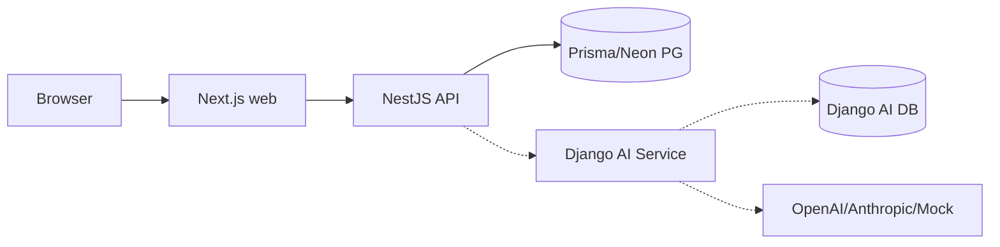
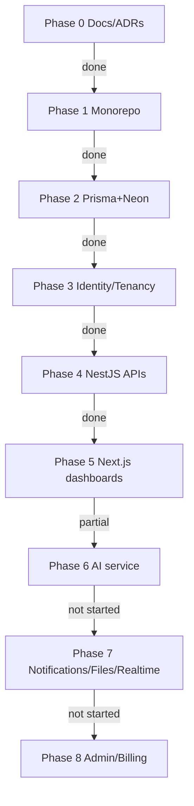

# TriFusion AI - Status Report

## Architecture (current)

## Phase Status

## Phase 6 - Done / Partial / Missing

- Done: Django apps (ai_gateway, providers, jobs, usage), auth.py token verify, mock provider, settings, ADR-008/009, NestJS ai module scaffold, circuit-breaker, guards, dto.
- Partial: Django lint broken (70 unused imports), in-memory quota, no PG models, no real providers wired, no typed contracts in packages/contracts, no frontend AI UI, no tests.
- Missing: streaming SSE, quota persistence, OpenAI/Anthropic adapters, contract tests, Playwright AI tests.

## Phase 7 - Not started

- Notifications, FileAsset, JobRecord schema; BullMQ workers; private S3 storage; realtime SSE/WebSocket; frontend notification bell & file UI; tests.

## Known blockers

- ruff lint fails (70 errors) in services/ai-django.
- Node lint/typecheck/test not yet run in this session.
- No .env validation for AI service vars in NestJS.

## Next actions

1. Fix Django lint (ruff --fix).
2. Run pnpm lint/typecheck/test/build.
3. Complete Phase 6 (Django PG + providers + contracts + NestJS integration + tests).
4. Then Phase 7.
EOF
echo created