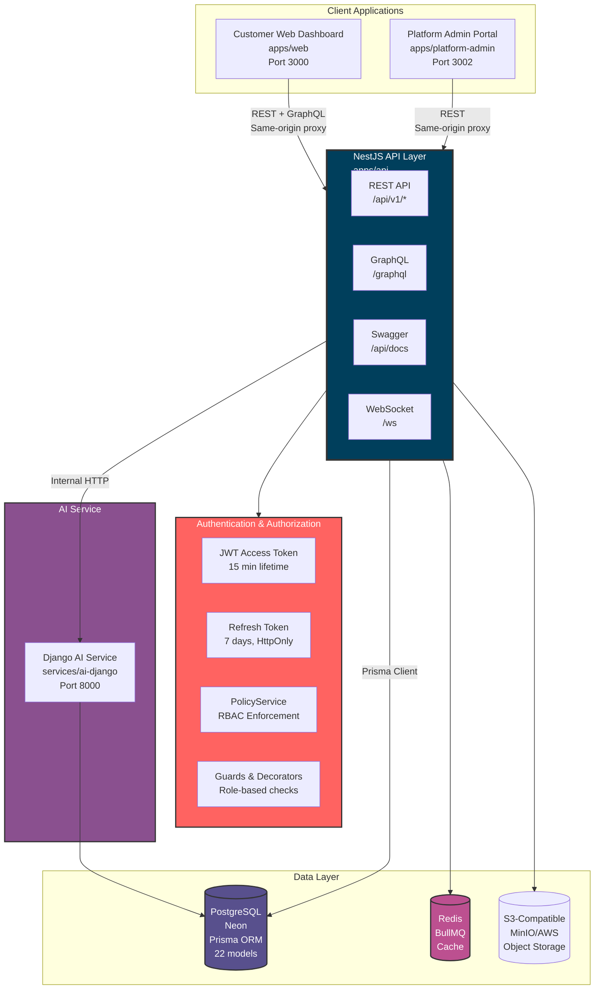
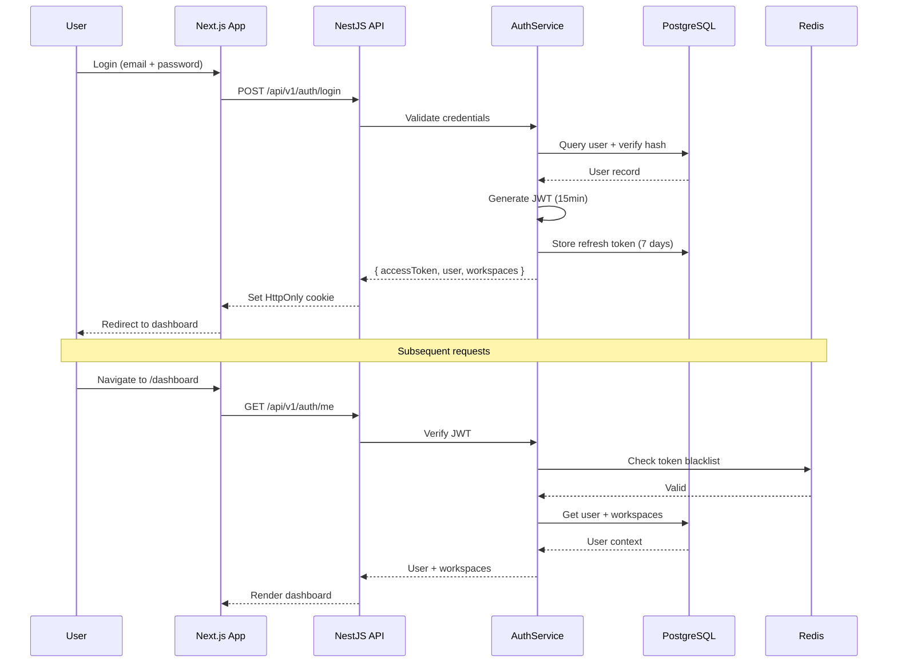
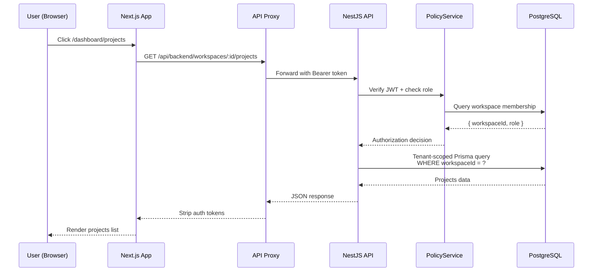

# TriFusion AI — System Architecture

> **Document Status:** Active / Baseline Architecture for TriFusion AI
> **Last Updated:** 2026-11-02
> **Architecture Pattern:** Modular Monolith with Next.js 16 App Router & NestJS 10 API

---

## Table of Contents

1. [Architecture Overview](#1-architecture-overview)
2. [System Diagrams](#2-system-diagrams)
3. [Monorepo Organization](#3-monorepo-organization)
4. [Technology Stack](#4-technology-stack)
5. [Tenancy & Authorization Model](#5-tenancy--authorization-model)
6. [Security & Isolation](#6-security--isolation)
7. [Data Flow & Request Lifecycle](#7-data-flow--request-lifecycle)
8. [Service Communication](#8-service-communication)
9. [Observability & Monitoring](#9-observability--monitoring)
10. [Deployment Architecture](#10-deployment-architecture)

---

## 1. Architecture Overview

TriFusion AI is an **AI-powered Business Workspace** designed for individuals, freelancers, digital agencies, and IT service companies. The system employs a **modular monolith** backend architecture paired with modern frontend web applications, ensuring:

- **Tenant Isolation**: Strict logical separation of customer workspaces
- **Privacy by Default**: No ambient access between tenants
- **Maintainability**: Clear separation of concerns, shared contracts
- **Horizontal Scalability**: Stateless API with Redis-backed state
- **Performance**: Optimized caching, connection pooling, and query optimization

### Key Architectural Principles

1. **Multi-Tenancy**: Single PostgreSQL database with logical workspace scoping
2. **Role-Based Access Control (RBAC)**: 8 roles across 2 disjoint authorization layers
3. **Separation of Concerns**: Platform staff layer completely isolated from customer workspace layer
4. **Defense in Depth**: Multiple security layers from transport to data
5. **Audit Trail**: Immutable, hash-chained activity logs for compliance

---

## 2. System Diagrams

### 2.1 High-Level Architecture



### 2.2 Authentication Flow



### 2.3 Data Flow - Request Lifecycle



### 2.4 Component Architecture

```mermaid
graph LR
    subgraph Frontend["Frontend Layer"]
        UI[Material UI Components]
        HOOKS[React Hooks<br/>useAuth, useWorkspace]
        QUERY[TanStack Query<br/>Caching & State]
        PROXY[API Proxy<br/>/api/backend/*]
    end

    subgraph Backend["Backend Layer"]
        CONTROLLERS[Controllers<br/>Route Handlers]
        SERVICES[Services<br/>Business Logic]
        REPOS[Repositories<br/>Data Access]
        GUARDS[Guards<br/>Auth & RBAC]
    end

    subgraph Data["Data Layer"]
        PRISMA[Prisma Client]
        POSTGRES[(PostgreSQL)]
    end

    UI --> HOOKS
    HOOKS --> QUERY
    QUERY --> PROXY
    PROXY --> CONTROLLERS
    CONTROLLERS --> GUARDS
    GUARDS --> SERVICES
    SERVICES --> REPOS
    REPOS --> PRISMA
    PRISMA --> POSTGRES

    style QUERY fill:#003F5C,stroke:#333,color:#fff
    style SERVICES fill:#58508D,stroke:#333,color:#fff
    style PRISMA fill:#FF6361,stroke:#333,color:#fff
```



---

## 3. Monorepo Organization

The project is structured as a **pnpm + Turborepo monorepo**:

```
trifusion-ai/
├── apps/
│   ├── api/                    # NestJS 10 REST API (port 3001)
│   │   ├── src/
│   │   │   ├── modules/        # Feature modules (auth, workspaces, clients, etc.)
│   │   │   ├── common/         # Shared code (guards, filters, decorators)
│   │   │   └── config/         # NestJS configuration
│   │   └── prisma/             # Prisma schema reference
│   ├── web/                    # Next.js 16 Customer Dashboard (port 3000)
│   │   ├── src/
│   │   │   ├── app/            # App Router pages
│   │   │   ├── components/     # React components
│   │   │   ├── contexts/       # React contexts (auth, workspace)
│   │   │   └── lib/            # Utilities (API client, hooks)
│   │   └── public/
│   └── platform-admin/         # Next.js 16 Platform Admin (port 3002)
│       ├── src/
│       │   ├── app/            # App Router pages
│       │   ├── components/     # React components
│       │   └── lib/            # Utilities
│       └── public/
├── packages/
│   ├── ui/                     # Shared Material UI design system
│   ├── contracts/              # Shared TypeScript types & Zod schemas
│   ├── config/                 # Shared ESLint/TypeScript config
│   └── utils/                  # Shared utilities (formatting, dates)
├── services/
│   └── ai-django/              # Django AI service (port 8000, optional)
├── database/
│   ├── prisma/                 # Prisma schema & migrations
│   ├── seeds/                  # Development seed scripts
│   └── docs/                   # Database documentation
├── docs/                       # Comprehensive documentation
├── tests/                      # E2E tests (Playwright)
└── package.json                # Turborepo workspace config
```

### Package Dependencies

```
┌─────────────────────────────────────────────────────────┐
│                    packages/ui                          │
│  Material UI components, theme tokens, shared styles     │
└────────────────────┬────────────────────────────────────┘
                     │
                     ├──────────────┬──────────────┐
                     ↓              ↓              ↓
            ┌─────────────┐ ┌─────────────┐ ┌─────────────┐
            │  apps/web   │ │ apps/admin  │ │ packages/   │
            │             │ │             │ │ contracts   │
            └──────┬──────┘ └──────┬──────┘ └──────┬──────┘
                   │                │               │
                   └────────┬───────┴───────────────┘
                            ↓
                   ┌─────────────────┐
                   │  packages/utils │
                   └─────────────────┘
```

---

## 4. Technology Stack

| Layer | Technology | Version | Rationale |
|-------|-----------|---------|-----------|
| **Monorepo** | Turborepo + pnpm | pnpm 8.15.0 | Fast builds, efficient dependency management |
| **Language** | TypeScript | 5.x | Type safety, better developer experience |
| **Customer Web** | Next.js 16 + React 19 | 16.0.0 | App Router, Server Components, streaming SSR |
| **Platform Admin** | Next.js 16 + React 19 | 16.0.0 | Same stack as web, consistent DX |
| **API** | NestJS 10 | 10.x | Modular architecture, DI, first-class OpenAPI |
| **UI Framework** | Material UI v7 + Emotion | v7 | Enterprise components, theming system |
| **API Docs** | Swagger / OpenAPI | @nestjs/swagger | Interactive API documentation |
| **GraphQL** | Apollo GraphQL | GraphQL 16 | Read-only analytics queries |
| **Database** | PostgreSQL (Neon) | 16+ | Relational consistency, ACID transactions |
| **ORM** | Prisma | v5 | Type-safe queries, migrations, schema management |
| **Cache/Queues** | Redis + BullMQ | ioredis v5 | Fast caching, distributed locks, job queues |
| **Auth** | JWT (passport-jwt) | - | Stateless authentication, token-based |
| **AI Service** | Python Django | 5.x | Specialized AI workloads (optional) |
| **Testing** | Jest + Playwright | Jest 29, Playwright 1.64 | Unit/E2E testing |
| **Linting** | ESLint + Prettier | ESLint 8, Prettier 3 | Code quality, formatting |

---

## 5. Tenancy & Authorization Model

### 5.1 Multi-Tenancy Model

TriFusion AI uses **logical multi-tenancy** within a single PostgreSQL database:

- **Workspace Boundary**: Every tenant-owned record belongs to a `Workspace` via `workspaceId`
- **Personal vs Company Workspaces**:
  - Every user gets a personal workspace on registration
  - Users can create or be invited to company workspaces
- **Tenant Isolation**: All queries are scoped to `workspaceId` at the service layer

### 5.2 Role-Based Access Control (RBAC)

**8 roles across 2 completely separate authorization layers:**

#### Customer Workspace Roles (`apps/web`)

| Role | Level | Purpose | Can Create? | Can Edit? | Can Delete? |
|------|-------|---------|-------------|-----------|-------------|
| `OWNER` | 4 | Full workspace control, billing, member management | ✅ | ✅ | ✅ |
| `TEAM_ADMIN` | 3 | Team administration, member management | ✅ | ✅ | ✅ (archive) |
| `MEMBER` | 2 | Standard contributor, tasks/projects | ✅ | ✅ | ❌ |
| `VIEWER` | 1 | Read-only stakeholder | ❌ | ❌ | ❌ |

#### Platform Staff Roles (`apps/platform-admin`)

| Role | Level | Purpose | Customer Data Access? |
|------|-------|---------|----------------------|
| `SUPERADMIN` | 4 | Platform configuration, staff management | ❌ (bounded only) |
| `PLATFORM_ADMIN` | 3 | Tenant/user activation, operations | ❌ (bounded only) |
| `ANALYST` | 1 | Analytics, telemetry, metrics | ❌ |
| `SUPPORT_AGENT` | 2 | Time-bounded, consent-based support | ❌ (session only) |

**Critical**: Platform roles never have ambient access to customer workspace data. Support access requires explicit consent and generates immutable audit logs.

### 5.3 Authorization Enforcement

```typescript
// Example: Workspace resource guard
@Injectable()
export class WorkspaceGuard implements CanActivate {
  constructor(
    private policyService: PolicyService,
    private reflector: Reflector,
  ) {}

  async canActivate(context: ExecutionContext): Promise<boolean> {
    const request = context.switchToHttp().getRequest();
    const user = request.user;
    const workspaceId = request.params.workspaceId;

    // Verify workspace membership
    const membership = await this.policyService.checkWorkspaceMembership(
      user.id,
      workspaceId,
    );

    if (!membership) {
      throw new ForbiddenException('Not a member of this workspace');
    }

    // Check role-based permissions
    const requiredRole = this.reflector.get<string>('role', context.getHandler());
    if (requiredRole && !this.policyService.hasRole(membership.role, requiredRole)) {
      throw new ForbiddenException('Insufficient permissions');
    }

    // Attach workspace context to request
    request.workspace = membership;
    return true;
  }
}
```

---

## 6. Security & Isolation

### 6.1 Defense in Depth

1. **Transport Layer**: TLS 1.3 enforced in production
2. **API Layer**: Global `ValidationPipe` with strict DTO whitelisting
3. **Guard Layer**: JWT verification, workspace membership, RBAC checks
4. **Service Layer**: Explicit `workspaceId` predicate in all Prisma queries
5. **Data Layer**: Foreign key constraints, indexed `workspaceId` columns

### 6.2 Token Strategy

| Token Type | Lifetime | Storage | Purpose |
|------------|----------|---------|---------|
| Access Token (JWT) | 15 minutes | HttpOnly cookie | API authentication |
| Refresh Token | 7 days | HttpOnly cookie (hashed in DB) | Token rotation |
| Reset Token | 1 hour | Hashed in DB | Password reset |
| Verification Token | 1 hour | Hashed in DB | Email verification |

### 6.3 Security Best Practices

- ✅ **Never commit** `.env` files, credentials, or secrets
- ✅ **Use HttpOnly, Secure, SameSite cookies** for tokens
- ✅ **Validate all inputs** on the server side
- ✅ **Parameterize all database queries** (Prisma handles this)
- ✅ **Rate limit** public endpoints (Redis + BullMQ)
- ✅ **Audit log** all privileged operations
- ✅ **Hash-chain** audit logs for tamper evidence
- ✅ **Last-owner protection** prevents workspace without OWNER
- ✅ **Last-SUPERADMIN protection** prevents platform without admin

---

## 7. Data Flow & Request Lifecycle

### 7.1 Authentication Request Flow

```
1. User submits login → POST /api/v1/auth/login
2. API validates credentials against database
3. API generates JWT access token (15min)
4. API stores refresh token in database (7 days)
5. API sets HttpOnly cookie with refresh token
6. API returns access token + user profile
7. Frontend stores access token in memory (not localStorage)
8. Frontend includes access token in Authorization header
9. API validates JWT on each request
10. API checks token blacklist in Redis
11. API executes business logic with workspace context
```

### 7.2 Resource Access Flow

```
1. User navigates to /dashboard/projects
2. Frontend checks if access token exists
3. Frontend calls GET /api/backend/workspaces/:id/projects
4. API guard verifies JWT signature and expiry
5. API guard checks workspace membership
6. API guard evaluates role-based permissions
7. Service layer executes Prisma query with workspaceId filter
8. Database returns tenant-scoped results
9. API returns JSON response
10. Frontend caches response in TanStack Query
11. Frontend renders UI components
```

---

## 8. Service Communication

### 8.1 Internal Communication

| Service A | Service B | Protocol | Purpose |
|------------|-----------|----------|---------|
| apps/web | apps/api | HTTP (REST) | Customer workspace operations |
| apps/platform-admin | apps/api | HTTP (REST) | Platform administration |
| apps/api | PostgreSQL | TCP (Prisma) | Data persistence |
| apps/api | Redis | TCP | Caching, queues, sessions |
| apps/api | services/ai-django | HTTP (REST) | AI feature requests |
| services/ai-django | PostgreSQL | TCP (Django ORM) | AI-related data |

### 8.2 External Integrations

| Integration | Purpose | Authentication |
|-------------|---------|----------------|
| Email Service (SMTP/SES) | User verification, notifications | API keys |
| S3-Compatible Storage | File uploads, documents | Access keys |
| AI Providers (OpenAI, Anthropic) | AI features | API keys |
| Payment Gateway (Stripe) | Billing | API keys |

---

## 9. Observability & Monitoring

### 9.1 Health Checks

- **Endpoint**: `/api/v1/health`
- **Checks**: Database connectivity, Redis connectivity, external service health
- **Response**: `{ status: 'ok', services: { database: 'up', redis: 'up' } }`

### 9.2 Logging

- **Format**: JSON-structured logs
- **Correlation**: Request ID (`x-request-id`) spans all services
- **Levels**: ERROR, WARN, INFO, DEBUG
- **Destinations**: Console (dev), CloudWatch/Sentry (prod)

### 9.3 Error Tracking

- **Framework**: Sentry for error aggregation
- **Filter**: Sensitive data stripped before sending
- **Alerts**: Critical errors trigger immediate notifications

### 9.4 Metrics

- **Application Metrics**: Request latency, error rates, active users
- **Database Metrics**: Query performance, connection pool usage
- **Cache Metrics**: Hit ratio, memory usage, queue depth
- **Infrastructure Metrics**: CPU, memory, disk I/O

---

## 10. Deployment Architecture

### 10.1 Development Environment

```
┌─────────────────────────────────────────────────────────┐
│                  Local Development                       │
├─────────────────────────────────────────────────────────┤
│  apps/web          → localhost:3000                     │
│  apps/api          → localhost:3001                     │
│  apps/platform-admin → localhost:3002                   │
│  services/ai-django → localhost:8000                   │
│  PostgreSQL        → localhost:5432 (or Neon)          │
│  Redis             → localhost:6379 (or Redis Cloud)     │
└─────────────────────────────────────────────────────────┘
```

### 10.2 Production Environment

```
┌─────────────────────────────────────────────────────────┐
│                  Production Deployment                   │
├─────────────────────────────────────────────────────────┤
│                                                         │
│  ┌─────────────┐    ┌─────────────┐    ┌─────────────┐ │
│  │  Load       │    │  Load       │    │  Load       │ │
│  │  Balancer   │    │  Balancer   │    │  Balancer   │ │
│  └──────┬──────┘    └──────┬──────┘    └──────┬──────┘ │
│         │                  │                  │        │
│         └──────────────────┼──────────────────┘        │
│                            ↓                           │
│  ┌─────────────────────────────────────────────────┐   │
│  │             Container Orchestration              │   │
│  │  (Kubernetes / Docker Swarm / AWS ECS)           │   │
│  └─────────────────────────────────────────────────┘   │
│                            │                           │
│         ┌──────────────────┼──────────────────┐        │
│         ↓                  ↓                  ↓        │
│  ┌──────────┐      ┌──────────┐      ┌──────────┐    │
│  │  apps/   │      │  apps/   │      │ services │    │
│  │  web     │      │  api     │      │ ai-django│    │
│  └────┬─────┘      └────┬─────┘      └────┬─────┘    │
│       │                │                │           │
│       └────────────────┼────────────────┘           │
│                        ↓                               │
│  ┌─────────────────────────────────────────────────┐   │
│  │              Managed Services                    │   │
│  │  PostgreSQL (Neon) | Redis (ElastiCache) | S3    │   │
│  └─────────────────────────────────────────────────┘   │
└─────────────────────────────────────────────────────────┘
```

### 10.3 Environment Configuration

| Environment | Database | Redis | Monitoring |
|-------------|----------|-------|------------|
| Development | Local/Neon dev | Local | Console logs |
| Staging | Neon staging | Redis Cloud | Sentry + CloudWatch |
| Production | Neon production | Redis Cloud | Sentry + CloudWatch + PagerDuty |

---

## Related Documentation

- [docs/ARCHITECTURE_DIAGRAMS.md](ARCHITECTURE_DIAGRAMS.md) - Additional Mermaid diagrams
- [docs/SECURITY.md](SECURITY.md) - Security policies and guidelines
- [docs/DATABASE_DESIGN.md](DATABASE_DESIGN.md) - Database schema and ERD
- [docs/DEPLOYMENT.md](DEPLOYMENT.md) - Deployment procedures
- [docs/ADRs/](ADRs/) - Architecture Decision Records
- [docs/ROLES_REFERENCE.md](ROLES_REFERENCE.md) - Role permissions matrix
